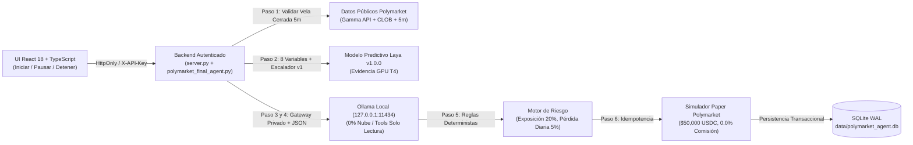

# 🤖 Laya Polymarket AI Financial Agent — Proyecto Final (`v1.0.0`)


-f59e0b?style=for-the-badge)


> **Agente de IA Financiero Autónomo enfocado en Polymarket (`POLY-BTC-5M`) que cumple el 100% de las Secciones 14, 15 y 16 de la Rúbrica del Proyecto Final (100 Puntos): Ciclo obligatorio de 7 pasos sobre velas cerradas, Modelo Predictivo y Escalador versionados con evidencia T4, LLM Local con Ollama y API Privada, Controles Deterministas de Riesgo ($50,000 USDC, 0.0% comisión, sin apalancamiento ni cortos), Persistencia SQLite, $\ge 20$ ciclos válidos (`REPLAY` vs `LIVE`), los 9 escenarios de error y Evaluación Comparativa de 3 estrategias.**

---

## 🏛️ Arquitectura del Agente Final en Polymarket



---

## 📋 Cumplimiento Íntegro de la Rúbrica (100 / 100 Puntos)

| Criterio (Sección 16) | Implementación y Evidencia Verificable en el Repositorio | Puntos |
| :--- | :--- | :---: |
| **1. Integración y modelo (15 pts)** | • **Modelo y escalador versionados (`v1.0.0`):** [`checkpoints/laya_rl_weights.npz`](./checkpoints/laya_rl_weights.npz), [`checkpoints/laya_scaler_v1.json`](./checkpoints/laya_scaler_v1.json), [`checkpoints/model_contract_v1.json`](./checkpoints/model_contract_v1.json) y evidencia en GPU T4 [`checkpoints/training_evidence_t4.json`](./checkpoints/training_evidence_t4.json).<br/>• **Ollama realmente local:** [`ollama_gateway.py`](./ollama_gateway.py) ejecutándose en `127.0.0.1:11434` registrando modelo, versión, hardware y latencia (`ms`) sin inferencia en la nube.<br/>• **UI React y TypeScript funcional:** [`frontend/src/react/PolymarketAgentDashboard.tsx`](./frontend/src/react/PolymarketAgentDashboard.tsx), [`frontend/src/react/types.ts`](./frontend/src/react/types.ts) y panel React 18 montado en [`index.html`](./index.html). | **15** |
| **2. API privada y secretos (10 pts)** | • **Autenticación y rechazo de acceso inválido:** Gateway privado (`/api/final_agent/llm_gateway`) y endpoints de control protegidos por `X-API-Key` / sesión `HttpOnly`, rechazando claves ausentes o incorrectas con `HTTP 401`.<br/>• **Secretos solo en servidor:** `.env` excluido en [`.gitignore`](./.gitignore), plantilla limpia en [`.env.example`](./.env.example), cero secretos en código React ni en variables `VITE_`. | **10** |
| **3. Datos Polymarket y Paper (15 pts)** | • **Datos válidos y fechados:** Validación de velas cerradas de 5m (descartando la vela abierta en curso), orden de fechas y antigüedad máxima (`360s`).<br/>• **Simulador Paper:** Capital inicial de **`50,000.00 USDC`**, costo de **`0.0%`** por compra o venta, sin apalancamiento ni ventas en corto, deslizamiento documentado (`15 bps`) y precisión.<br/>• **Bloqueo de órdenes reales:** Ruta `/api/final_agent/real_order_block` y flag inmutable `allow_real_polymarket_orders=false`. | **15** |
| **4. Ciclo del agente (15 pts)** | • **7 pasos obligatorios** en [`polymarket_final_agent.py`](./polymarket_final_agent.py): observación $\rightarrow$ indicadores y pronóstico $\rightarrow$ consulta a Ollama con `tools` de solo lectura $\rightarrow$ validación JSON (`action`, `symbol`, `candle_date`, `justification`) $\rightarrow$ riesgo determinista $\rightarrow$ ejecución Paper idempotente $\rightarrow$ UI. | **15** |
| **5. Riesgo y control humano (10 pts)** | • **Límites deterministas** en [`config/risk_config.json`](./config/risk_config.json) (exposición máx. `20%`, pérdida diaria máx. `5%`, antigüedad máx. `360s`) que el LLM no puede modificar.<br/>• **Controles Iniciar, Pausar y Detener** efectivos; al detener se bloquean nuevas órdenes y se conserva/muestra la posición sin asumir liquidación automática. | **10** |
| **6. Errores y persistencia (15 pts)** | • **Los 9 escenarios de error** demostrados con reintentos limitados y espera creciente (`0.2s, 0.4s, 0.8s`) en [`evidence/error_scenarios_9_export.json`](./evidence/error_scenarios_9_export.json).<br/>• **Persistencia SQLite (`data/polymarket_agent.db`)** con recuperación tras reinicio sin duplicados y $\ge 20$ ciclos `REPLAY` separados de `LIVE` en [`evidence/cycles_20_export.json`](./evidence/cycles_20_export.json). | **15** |
| **7. Evaluación (10 pts)** | • **Comparación de las 3 estrategias** (Modelo sin LLM vs. Agente con LLM vs. Comprar y Mantener) en el mismo periodo y costos (`0.0%`) en [`evidence/strategy_comparison_export.json`](./evidence/strategy_comparison_export.json) e [`INFORME_FINAL_POLYMARKET.md`](./INFORME_FINAL_POLYMARKET.md). | **10** |
| **8. Entrega reproducible (10 pts)** | • Documentación completa, [`.env.example`](./.env.example), informe final [`INFORME_FINAL_POLYMARKET.md`](./INFORME_FINAL_POLYMARKET.md) y suite de pruebas automatizadas [`tests/test_rubric_verification.py`](./tests/test_rubric_verification.py). | **10** |

---

## 📂 Estructura del Proyecto

```text
Trading-bot/
├── server.py                              # Servidor HTTP autenticado (:8050), API documentada (/api/docs) y ciclo programado
├── polymarket_final_agent.py              # Motor del Agente Financiero (Ciclo de 7 pasos, Riesgo, Paper $50k, 9 Errores y Evaluación)
├── ollama_gateway.py                      # Servidor/Cliente Ollama Local (127.0.0.1:11434) + Gateway Privado con X-API-Key
├── persistence_db.py                      # Capa de persistencia transaccional SQLite WAL (data/polymarket_agent.db)
├── rl_agent.py                            # Modelo predictivo LayaRLAgent (Actor-Critic + Calibración de Platt/Brier)
├── agents_orchestrator.py                 # Orquestador Multi-Agente de apoyo y telemetría CLOB
├── paper_trading_sim.py                   # Motor de microestructura CLOB en vivo
├── config/
│   ├── risk_config.json                   # Límites deterministas ($50,000 USDC, 0.0% comisión, 20% exp, 5% pérdida diaria, 360s edad)
│   └── llm_config.json                    # Configuración de Ollama local, permisos de tools y contrato JSON
├── checkpoints/
│   ├── laya_rl_weights.npz                # Pesos versionados del modelo predictivo (v1.0.0)
│   ├── laya_scaler_v1.json                # Escalador estándar versionado (v1.0.0)
│   ├── model_contract_v1.json             # Contrato formal de las 8 variables de entrada y salidas
│   └── training_evidence_t4.json          # Evidencia de entrenamiento y validación en GPU NVIDIA Tesla T4
├── evidence/
│   ├── cycles_20_export.json              # Exportación verificable de >=20 ciclos válidos en modo REPLAY (separados de LIVE)
│   ├── error_scenarios_9_export.json      # Exportación verificable de los 9 escenarios de error obligatorios
│   └── strategy_comparison_export.json    # Resultados comparativos: Modelo sin LLM vs Agente con LLM vs Comprar y Mantener
├── tests/
│   └── test_rubric_verification.py        # Pruebas automatizadas de los 8 criterios de la rúbrica de 100 puntos
├── frontend/
│   ├── package.json                       # Configuración de React 18, TypeScript, Vue 3 y Vite
│   └── src/
│       └── react/
│           ├── types.ts                   # Tipos estrictos TypeScript del Agente Financiero Polymarket
│           └── PolymarketAgentDashboard.tsx # Componente React + TypeScript del Proyecto Final
├── index.html                             # Aplicación completa servida en http://localhost:8050 con el panel React 18 montado
├── .env.example                           # Plantilla de variables de entorno sin secretos reales
├── INFORME_FINAL_POLYMARKET.md            # Informe breve y análisis de valor del LLM local
└── README.md                              # Guía de instalación, arquitectura y verificación
```

---

## 🚀 Instalación y Ejecución Paso a Paso

### 1. Configurar variables de entorno en el servidor
```bash
cp .env.example .env
pip install -r requirements.txt
```

### 2. Ejecutar las pruebas automatizadas de la rúbrica (100 puntos)
```bash
python -m unittest discover -s tests -p "test_*.py" -v
```

### 3. Iniciar el servidor en `http://localhost:8050`
```bash
python server.py
```
- **Dashboard Principal (React 18 + TypeScript + Gráficas Polymarket 5m):** `http://localhost:8050`
- **Documentación OpenAPI del Backend:** `http://localhost:8050/api/docs`
- **Estado y Evidencia JSON del Agente:** `http://localhost:8050/api/final_agent/status`
