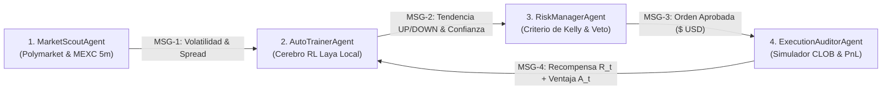

# 🤖 Laya Trading Bot — Polymarket & MEXC 5m Volatility (`v0.1.0`)


> **Entrega Oficial `v0.1.0` — Bot de Trading Autónomo con Aprendizaje por Refuerzo (RL) 100% Local, Orquestación Multi-Agente e Interfaz en Vue 3 + Vite + TypeScript para Contratos de 5 Minutos en Polymarket y MEXC.**

---

## 📌 Resumen del Proyecto (`Versión 0.1.0`)

**Laya Trading Bot (`v0.1.0`)** es un sistema autónomo de predicción cuantitativa y simulación de ejecución en tiempo real (Paper Trading sobre el libro de órdenes centralizado **CLOB**) diseñado para operar la volatilidad a **5 minutos de Bitcoin (`BTC Up or Down 5m`)** integrando **Polymarket** y **MEXC Exchange**.

### 🔒 Principio Indispensable de Seguridad (`100% Local Inference & Zero API Keys`)
* **Ejecución de IA 100% Local**: Tanto la red neuronal **Laya** (*Actor-Critic Reinforcement Learning*) como el **Orquestador de 4 Agentes** se ejecutan íntegramente en la máquina local.
* **Cero Exposición de Credenciales (`No pasar API a I.A.`)**: El bot consume flujos públicos de mercado (`WebSockets` y `REST` públicos de Polymarket y MEXC) sin almacenar ni enviar API Keys o llaves privadas a servicios externos de IA.

---

## 🛠️ Tecnologías Aplicadas

| Capa del Sistema | Tecnologías y Protocolos Aplicados | Propósito en `v0.1.0` |
| :--- | :--- | :--- |
| **Frontend / UI Reactiva** | **TypeScript 5.5**, **Vite 5**, **Vue 3** (`<script setup lang="ts">`), **Chart.js 4**, **HTML5 Canvas 2D** | Interfaz modular tipada en [`frontend/`](./frontend) con gráfica superpuesta en tiempo real (`+15s`), terminal *One-Tap Buy* y **Orquesta Estelar de Agentes** (fotones en curvas de Bézier). |
| **Motor de IA / RL Local** | **Python 3.12**, **NumPy** (Tensores vectorizados en local) | Red neuronal **Actor-Critic** en línea con activación GELU, calibración de confianza por **Brier Score**, escalado de temperatura de Platt ($T$) y umbral adaptativo ($\tau^*$). |
| **Orquestación Multi-Agente** | Arquitectura de 4 Agentes Autónomos + Bus de Mensajes (`MSG-1` a `MSG-4`) | Coordinación entre `MarketScoutAgent`, `AutoTrainerAgent`, `RiskManagerAgent` (Criterio de **Kelly Fraccional** $0.25\times$) y `ExecutionAuditorAgent`. |
| **Mercados & Oráculos (`~1 ms`)** | **Polymarket** (`Gamma API`, `CLOB WebSocket`, `RTDS Chainlink BTC/USD`) & **MEXC Exchange** (`wss://wbs.mexc.com/ws` `BTC_USDT`) | Sincronización en tiempo real de precios, libro de órdenes (`Ask`/`Bid` en centavos) y reloj **UTC Atómico** (cero desfase de reloj local). |
| **Modelado de Volatilidad** | Estimadores **Parkinson (5m)**, **Garman-Klass (5m)** y **GARCH(1,1)** | Captura de expansión de rango intrabarra, presión *Taker Buy/Sell* y detección de regímenes de volatilidad. |

---

## 🌌 Arquitectura del Orquestador Multi-Agente (4 Nodos Locales)



---

## 📂 Estructura Limpia del Repositorio

```text
Trading-bot/
├── frontend/                              # UI en Vue 3 + Vite + TypeScript
│   ├── package.json                       # Configuración de dependencias Vue 3, Vite y TypeScript
│   ├── tsconfig.json                      # Configuración estricta del compilador TypeScript
│   ├── vite.config.ts                     # Configuración de Vite + Proxy hacia el backend local (8050)
│   ├── index.html                         # Punto de montaje de la aplicación Vue 3
│   └── src/
│       ├── main.ts                        # Inicialización de Vue 3
│       ├── App.vue                        # Dashboard principal (Polymarket & MEXC + Gráfica Laya)
│       ├── style.css                      # Paleta oscura fintech y estilos responsivos
│       ├── types/
│       │   └── trading.ts                 # Interfaces TypeScript (Oráculos, CLOB, Agentes y RL)
│       ├── services/
│       │   └── marketFeeds.ts             # Cliente WebSocket tipado (Polymarket RTDS/CLOB + MEXC + Reloj Atómico)
│       └── components/
│           ├── LiveBetTerminal.vue        # Terminal de apuestas con contabilidad real del CLOB
│           └── ConstellationCanvas.vue    # Orquesta de 4 estrellas y fotones en curvas de Bézier
├── server.py                              # Servidor HTTP multihilo local, sincronizador UTC atómico y endpoints REST
├── rl_agent.py                            # Agente Actor-Critic RL 100% local (LayaRLAgent)
├── agents_orchestrator.py                 # Orquestador de los 4 agentes inteligentes y bus de mensajes
├── paper_trading_sim.py                   # Motor de simulación CLOB en tiempo real y backtesting de 96 velas
├── index.html                             # Bundle autónomo pre-compilado servido directamente en :8050
├── checkpoints/                           # Pesos entrenados (.npz) e historial de aprendizaje (.json)
├── requirements.txt                       # Dependencias de Python (NumPy)
├── .gitignore                             # Exclusión de caché y protección estricta contra credenciales
└── README.md                              # Documentación oficial de la entrega v0.1.0
```

---

## 🚀 Instalación y Uso Rápido

### 1. Clonar el repositorio
```bash
git clone https://github.com/DanielJuarez-AI/Trading-bot.git
cd Trading-bot
```

### 2. Iniciar el Backend Local (Python + Motor RL Local)
```bash
pip install -r requirements.txt
python server.py
```
*(El servidor local queda disponible inmediatamente en `http://localhost:8050`).*

### 3. Ejecutar el Frontend en Modo Desarrollo (`Vue 3 + Vite + TypeScript`)
```bash
cd frontend
npm install
npm run dev
```
*(Abre `http://localhost:5173` con Hot-Module Replacement conectado al backend en `:8050`, o accede directamente a `http://localhost:8050`).*
