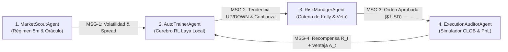

# 🤖 Laya Trading Bot — Polymarket & Crypto 5m Volatility (`v0.1.0`)


> **Entrega Oficial `v0.1.0` — Bot de Trading Autónomo con Aprendizaje por Refuerzo (RL) 100% Local y Orquestación Multi-Agente para Contratos Binarios de 5 Minutos (`BTC Up or Down 5m`).**

---

## 📌 Resumen del Proyecto (`Versión 0.1.0`)

**Laya Trading Bot** es un sistema autónomo de predicción cuantitativa y simulación de ejecución en tiempo real (Paper Trading sobre el libro de órdenes centralizado **CLOB**) diseñado para operar la volatilidad a **5 minutos de Bitcoin** en **Polymarket** (con soporte de flujos de precios spot de alta frecuencia compatibles con **Polymarket RTDS / Chainlink**, **MEXC**, **Coinbase** y **Binance**).

### 🔒 Principio de Seguridad y Privacidad (`100% Local Inference`)
* **Ejecución 100% Local**: Tanto el modelo neuronal **Laya** (Actor-Critic Reinforcement Learning) como el **Orquestador de 4 Agentes** se ejecutan íntegramente en la máquina local.
* **Cero Exposición de Credenciales (`Zero-Trust`)**: El bot consume flujos públicos de mercado en tiempo real sin enviar llaves privadas ni API Keys a modelos o servicios externos de IA.

---

## 🛠️ Tecnologías Aplicadas

| Capa del Sistema | Tecnologías y Protocolos Aplicados | Propósito en `v0.1.0` |
| :--- | :--- | :--- |
| **Motor de IA / RL Local** | **Python 3.12**, **NumPy** (Tensores vectorizados en local) | Red neuronal **Actor-Critic** en línea con activación GELU, calibración de confianza por **Brier Score**, escalado de temperatura de Platt ($T$) y umbral adaptativo ($\tau^*$). |
| **Orquestación Multi-Agente** | Arquitectura de 4 Agentes Autónomos + Bus de Mensajes (`MSG-1` a `MSG-4`) | Coordinación entre `MarketScoutAgent`, `AutoTrainerAgent`, `RiskManagerAgent` (Criterio de **Kelly Fraccional** $0.25\times$) y `ExecutionAuditorAgent`. |
| **Mercados & Oráculos (`~1 ms`)** | **Polymarket Gamma API**, **Polymarket CLOB WebSocket**, **RTDS Chainlink (`btc/usd`)**, **MEXC / Spot BookTicker WebSockets** | Sincronización en tiempo real de precios, libro de órdenes (`Ask`/`Bid` en centavos) y reloj **UTC Atómico** (cero desfase de reloj local). |
| **Modelado de Volatilidad** | Estimadores **Parkinson (5m)**, **Garman-Klass (5m)** y **GARCH(1,1)** | Captura de expansión de rango intrabarra, presión *Taker Buy/Sell* y detección de regímenes de volatilidad. |
| **Interfaz Gráfica (UI)** | **HTML5 / CSS3**, **Chart.js**, **HTML5 Canvas 2D** *(Preparado para migración modular a **TypeScript + Vite + Vue 3**)* | Gráfica estilo Polymarket con predicción de Laya superpuesta (`+15s`), terminal *One-Tap Buy* con contabilidad CLOB real y **Orquesta Estelar de Agentes** (fotones en curvas de Bézier). |

---

## 🌌 Arquitectura del Orquestador Multi-Agente (4 Nodos Locales)



1. **`MarketScoutAgent`**: Monitorea la volatilidad Parkinson/Garman-Klass a 5 minutos y clasifica el régimen del mercado (`COMPRESION_BAJA_VOL`, `REGIMEN_NORMAL`, `ALTA_VOLATILIDAD`, `EXPLOSION_VOLATILIDAD`).
2. **`AutoTrainerAgent` (Modelo Laya Local)**: Ejecuta el paso *forward/backward* del Actor-Critic en local, proyectando el precio de cierre a `+15s` y emitiendo la señal booleana (`TRUE` / `FALSE`) junto con la dirección (`▲ COMPRA UP` o `▼ COMPRA DOWN`).
3. **`RiskManagerAgent`**: Calcula el tamaño óptimo de posición mediante el **Criterio de Kelly Fraccional ($0.25\times$)** y bloquea entradas si el *spread* del libro de órdenes supera el umbral de seguridad.
4. **`ExecutionAuditorAgent`**: Gestiona la banca virtual (`$1,000.00 USD` iniciales) descontando el costo real del *Ask* al abrir y liquidando a `$1.00/share` al cierre de la ventana de 5 minutos (o al *Bid* actual en caso de *Cashout* anticipado), retroalimentando la recompensa $R_t$ al agente RL.

---

## 📂 Estructura Limpia del Repositorio

```text
Trading-bot/
├── server.py                 # Servidor HTTP multihilo local, sincronizador UTC atómico y endpoints REST
├── rl_agent.py               # Agente Actor-Critic RL local (LayaRLAgent) y calibración Brier
├── agents_orchestrator.py    # Orquestador de los 4 agentes inteligentes y bus de mensajes
├── paper_trading_sim.py      # Motor de simulación CLOB en tiempo real y backtesting de 96 velas (8h)
├── index.html                # Dashboard en tiempo real (WebSockets ~1ms, gráfica superpuesta y constelación)
├── checkpoints/              # Pesos entrenados (.npz) e historial de aprendizaje (.json)
├── requirements.txt          # Dependencias mínimas de ejecución local
├── .gitignore                # Reglas de exclusión de caché y protección de credenciales
└── README.md                 # Documentación técnica de la versión v0.1.0
```

---

## 🚀 Instalación y Uso Rápido

### 1. Clonar el repositorio e instalar dependencias
```bash
git clone https://github.com/DanielJuarez-AI/Trading-bot.git
cd Trading-bot
pip install -r requirements.txt
```

### 2. Iniciar el servidor local
```bash
python server.py
```

### 3. Abrir el Dashboard en Tiempo Real
Abre tu navegador en:
```text
http://localhost:8050
```

---

## 🗺️ Roadmap hacia `v0.2.0`
* [x] **v0.1.0**: Motor RL Actor-Critic 100% local, Orquestador de 4 Agentes, Sincronización UTC Atómica con Polymarket `BTC Up or Down 5m` y Simulador CLOB en vivo.
* [ ] **v0.2.0**: Migración del frontend a **Vue 3 + Vite + TypeScript** con componentes reactivos desacoplados y conector adicional de arbitraje de volatilidad con **MEXC Futures / Spot**.
